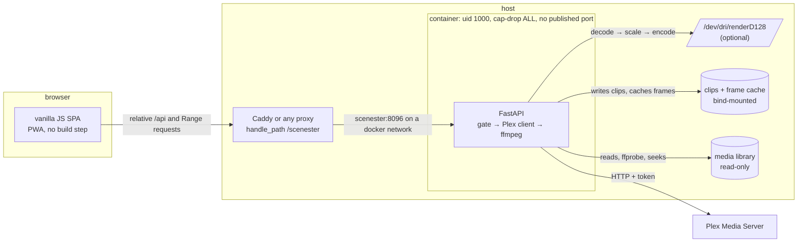

# Scenester

**Clip movies from your Plex library by selecting the lines of dialogue you
want.** Browse, scrub a live preview, mark a range, and download a
frame-accurate 1080p clip.

[](https://github.com/vacuumboots/scenester/actions/workflows/ci.yml)
[](https://github.com/vacuumboots/scenester/actions/workflows/docker-publish.yml)
[](#development)
[](https://www.python.org)
[](LICENSE)
[](https://github.com/vacuumboots/scenester/releases)

Self-hosted, one container, no database. Runs unprivileged, exports through
ffmpeg on the server, and uses an Intel iGPU when there is one.

<p align="center">
  
  <br>
  <sub>Filter → open → mark a 13s range while it plays → export. This is a capture of a
  live instance, produced by <code>scripts/record_demo.py</code>, not a mockup.</sub>
</p>

<p align="center">
  
  <br>
  <sub>The library — every title in your Plex server, searchable and sortable. The banner shows what's playing right now.</sub>
  <br><br>
  
  <br>
  <sub>The editor — the movie streams right in the page; mark a start and an end and download the clip.</sub>
</p>
<p align="center">
  
  <br>
  <sub>Editing by dialogue — select the lines you want and the clip range follows. Six lines here become a 23.6s clip.</sub>
</p>
<p align="center">
  
  <br>
  <sub>Quote search — remember the line, not the movie. 885 matches for &quot;what the hell&quot;, each one a click away from clipping.</sub>
</p>
<p align="center">
  
  <br>
  <sub>Fine-tuning — nudge each edge by single frames if you want, with an optional thumbnail film strip for jumping around.</sub>
</p>
<p align="center">
  
  
  
</p>
<p align="center">
  <sub>Searching within one movie's transcript · the whole workflow on a phone</sub>
</p>

## What it does

Most clip tools make you drag slider handles and pray. Scenester already reads
your subtitles, so the clip range is not an abstract timeline — it *is* the
script.

- **Edit by dialogue** — every line under the playhead is listed with its
  timestamp. Tap a line to select it, shift-tap to extend, and the clip's start
  and end snap to the dialogue you picked. Mark Start/End instead and the
  covered lines light up. Two views of one edit, always in sync.
- **Search quotes across the whole library** — flip the search box to **Lines**
  and type any phrase to find which film says it, at what timestamp, and jump
  in ready to clip.
- **Audition before committing** — double-tap a line to loop exactly that span.
- **Frame-precise nudging** — −30s −10s −5s −1f +1f +5s +10s +30s on each edge
  (1 frame ≈ 0.04s). Buttons, because fat thumbs exist.
- **Optional caption burn-in, 9:16 vertical crop, MP4 or GIF.**
- **Full editing on a phone**, not just desktop — portrait and landscape.
- **Plex OAuth login** (PIN flow) or a pre-set token; a now-playing banner with
  Quick Clip for whatever is paused in Plex right now.

## Architecture



No database. Configuration is environment variables; the Plex token and the
derived-artefact cache live in one volume; clips are plain files on disk.

## Design decisions

Each of these replaced something that was measurably worse, and there is a
comment at the code explaining the failure that motivated it.

- **Re-encode, never stream copy.** Stream copy can only cut on keyframes, which
  is seconds off from the line you clicked. Every clip is decoded and re-encoded
  so the cut lands on the frame you marked.
- **Subtitles are an editing surface, not decoration.** The `.srt` parser feeds
  three features at once: line selection, cross-library quote search, and
  caption burning. The clip range and the script are the same object.
- **Clip identity is a content key.** The filename carries title, year, media
  id, range and every render option, because the cache *is* the filename: any
  option that changes pixels must change the name, or the export silently
  re-serves the previous render. Title-only names collided across same-titled
  films (this library has three called *Mother*) and across non-Latin titles,
  which all slugged to `unknown`.
- **Existence is not completion.** Encodes write `<name>.part`, get verified
  with `ffprobe` for a positive duration, and are only then `os.replace`d into
  place. `-movflags +faststart` writes the index last, so a killed encode leaves
  a file that looks fine and no player can open.
- **Unprivileged by default, gate in the app.** A reverse proxy cannot
  authenticate per-app when one Caddy terminates TLS for twenty services, so
  the shared secret lives in the app, the container runs as uid 1000 with no
  capabilities, and no host port is published at all.
- **Relative URLs everywhere.** The same build works at `:8096/`, at
  `/scenester/` behind `handle_path`, and behind any other prefix-stripping
  proxy, with no configuration and no `<base>` tag.

## Measured

Numbers from the host this runs on (4-core Haswell i5, media on spinning
disks), not estimates:

| What | Before | After |
|---|---|---|
| 60s clip encode, hardware path | ~111s (libx264) | ~11s (VAAPI) |
| 12s clip encode, measured end to end | — | 3.21s (3.7× realtime) |
| Library listing payload | ~490 KB | ~88 KB gzipped |
| Library listing, warm | — | ~0.26s |
| Cold film-strip frame | — | ~1.3s per frame (a real seek) |
| Tests | 0 | 94 |
| Image rebuild, frontend-only change | 10–15 min | ~2.5s |

## Limitations

Real ones, in the order they are likely to bite:

- **Multi-part films only clip in part 1.** The timeline uses Plex's whole-item
  duration while the path translation returns one part, so a range past the
  first part seeks past EOF. Eight items in this library are affected.
- **`.srt` only.** One directory has `.ass`/`.ssa` without an `.srt`, and about
  a quarter of titles have no subtitle file at all — those get no line
  selection and no captions.
- **Previews stream the original file.** There is no 480p proxy, so scrubbing a
  4K remux is limited by the disk, not the CPU. That is a deliberate trade
  (no transcode chain to tune) and it is why the film strip is opt-in.
- **One library, one user, one Plex server.** No accounts, no sharing, no
  multi-tenant anything.
- **Quote search builds an in-memory index** (~2,100 films, ~1.2M subtitle
  lines here — tens of seconds of seeks on first use) and rebuilds after a
  restart.
- **No share targets.** Uploading straight to a platform is an open question,
  not a missing feature: the tool ends at "download the file".

## Setup

One container, one command. Everything else has a default.

```bash
git clone https://github.com/vacuumboots/scenester.git
cd scenester
cp .env.example .env          # set PLEX_URL and (recommended) an access token
docker compose up -d
```

Then open `http://localhost:8096` and sign in with Plex (or put
`PLEX_TOKEN` in `.env`).

Two things the compose file asks you to know about your own machine:

1. **`PLEX_MEDIA_PATH`** — the left side of the media bind mount must be the
   folder your Plex library reports its files in. Read-only, because Scenester
   never writes media.
2. **Ownership** — the container runs as uid 1000 and the clip and cache binds
   must be writable by it: `mkdir -p clips data && sudo chown -R 1000:1000 clips data`.
   There are `PUID`/`PGID`/`RENDER_GID` variables in the compose file if your
   ids differ. `getent group render` gives the gid the VAAPI device needs.

<details>
<summary>Not using Compose?</summary>

```bash
docker run -d --name scenester \
  --user 1000:1000 --group-add 992 \
  --cap-drop=ALL --security-opt=no-new-privileges \
  --memory=3g --cpus=3 --pids-limit=512 \
  --add-host=host.docker.internal:host-gateway \
  --device /dev/dri/renderD128 \
  --env-file .env \
  -p 127.0.0.1:8096:8096 \
  -v /path/to/your/media:/media:ro \
  -v "$PWD/clips:/tmp/clips" -v "$PWD/data:/data" \
  --restart unless-stopped \
  ghcr.io/vacuumboots/scenester:latest
```

Drop `--device` and set `SCENESTER_DISABLE_VAAPI=1` on a host with no render
node. Drop `-p` entirely if a reverse proxy reaches the container by name on a
shared Docker network — that is how this instance runs.
</details>

### Behind a reverse proxy

Any proxy that strips a path prefix works. Caddy:

```
handle_path /scenester/* {
    reverse_proxy scenester:8096
}
```

`scenester:8096` is the container name on a shared Docker network. Pointing the
proxy at a published host port also works, but then the port exists for no
reason.

## Configuration

Every setting is optional and documented with its default in
[`.env.example`](.env.example). The ones that change behaviour:

| Variable | Default | What it does |
|---|---|---|
| `PLEX_URL` | `http://host.docker.internal:32400` | Where Plex is |
| `PLEX_TOKEN` | — | Skip the in-app login |
| `SCENESTER_ACCESS_TOKEN` | — | Shared secret for the API. Unset means open |
| `SCENESTER_FRAME_CONCURRENCY` | `2` | Concurrent frame extractions. **The load lever** |
| `SCENESTER_CLIP_CONCURRENCY` | `2` | Concurrent encodes (each is a full pipeline) |
| `SCENESTER_CACHE_MAX_AGE_DAYS` | `14` | Prune cached frames/thumbnails |
| `SCENESTER_CLIP_MAX_AGE_DAYS` | `0` | Prune finished clips (0 = keep) |
| `SCENESTER_DISABLE_VAAPI` | — | Force the CPU encoder |

Only the first two matter on a dedicated host. On a box shared with Plex, the
two concurrency values decide whether opening the film strip makes everything
else slow: 12 concurrent frame requests once took this host from load 2.1 to
8.6. Each frame is a physical seek.

## Security

Scenester is built to sit on a private network behind a reverse proxy.

- **The API has a shared-secret gate.** Set `SCENESTER_ACCESS_TOKEN` and every
  `/api/*` route requires it: `X-Scenester-Token: <token>` for scripts, or the
  browser's unlock screen, which exchanges the token for an HttpOnly cookie.
  Unset means off, which is only sane when nothing but you can reach the
  container.
- **Nothing is published by default in the compose file** beyond
  `127.0.0.1:8096`.
- **The container runs unprivileged** — uid 1000, `--cap-drop=ALL`,
  `no-new-privileges`, and only the render device. It never needs root: no
  package installs, no privileged ports, no writes outside its two volumes.
- **Plex PINs are bound to the client that created them.** Without that binding
  any reachable client could start a PIN, approve it with its own Plex account
  and overwrite the stored token.
- **The Plex token is a file in `/data`**, not in the image or the environment,
  unless you pass `PLEX_TOKEN`.

The gate is one shared secret, so it separates "someone on my network" from
"me". If you need actual user accounts, this is the wrong tool and the
multi-user line in the [roadmap](ROADMAP.md) is deliberately a non-goal.

## Development

The frontend needs no build step: plain ES5, one stylesheet, relative URLs.

```bash
pip install -r backend/requirements.txt -r backend/requirements-dev.txt
uvicorn main:app --reload --app-dir backend
python -m pytest -q
```

Dependencies are installed in the image from `backend/requirements.lock.txt`
with `--require-hashes`. After changing `requirements.txt`:

```bash
pip-compile --generate-hashes --output-file requirements.lock.txt requirements.txt
```

`STATIC_DIR` resolves automatically (container layout first, then the repo's
`frontend/`). CI runs the pytest suite, `node --check` on the frontend, builds
the image, and smoke-tests it against `/healthz` before anything is published.

`/healthz` is the real readiness probe — it checks cache writability, ffmpeg and
ffprobe, and the media mount. `/` and `/api/auth/status` stay 200 when the app is
useless, which is why the container healthcheck does not use them.

The README's demo loop is generated rather than hand-recorded:
`scripts/record_demo.py` drives a real instance in headless Chrome over the
DevTools Protocol, clicks the app's own buttons, and captures frames for ffmpeg
to assemble. Point it at your own instance to re-shoot the loop.

### Keyboard shortcuts

| Key | Action |
|-----|--------|
| I / O | Mark clip start / end |
| Space | Play / pause |
| ← → | Nudge start ±1s (Shift = ±10s) |
| Alt + ← → | Nudge end ±1s (Shift = ±10s) |
| Enter | Download clip |
| Escape | Back to library |

## How this was built

Started as a tool for one thing I actually do — cutting clips out of films to
post — and grew for four months of daily use. The specific bug stories are in
[`CHANGELOG.md`](CHANGELOG.md) (23 dated entries), the self-audit is in
[`docs/audits/`](docs/audits/), and what is next is in [ROADMAP.md](ROADMAP.md).

I wrote it with an AI assistant (DeepSeek) doing much of the typing, which I
say plainly because it changes what the code is evidence of: the design
decisions, the debugging, the measurements and every claim in this README are
mine to defend, and the mistakes are in the changelog next to the fixes.
Debugging a pure-green encode caused by a corrupt NV12 surface coming back from
`hwdownload` on i965 is not something a model did for me — that one took a
session with `ffmpeg -loglevel debug` and a colour histogram.

## License

MIT
