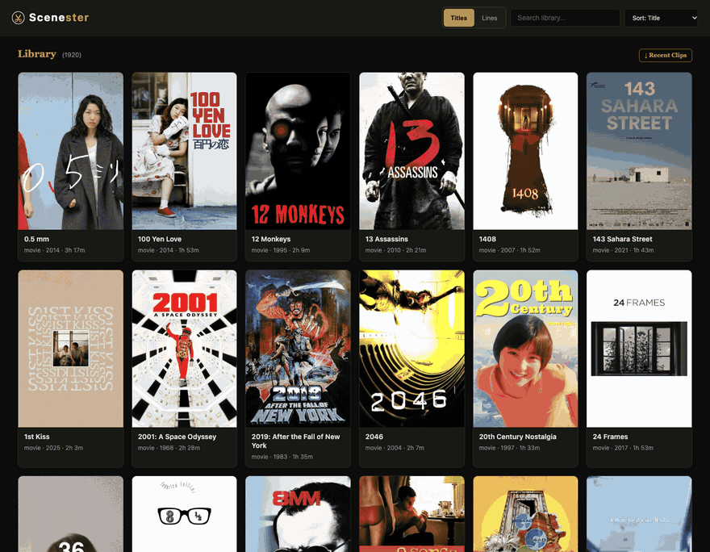
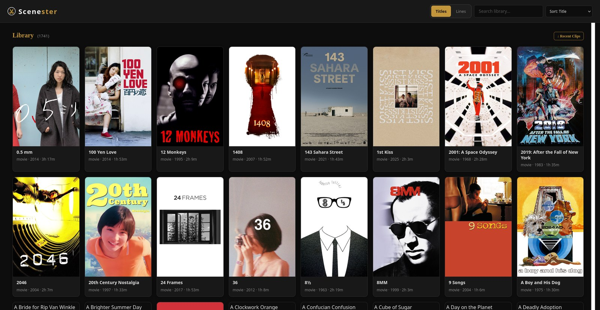
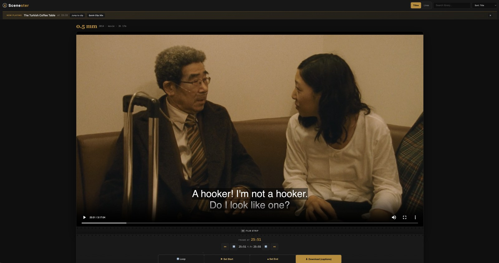
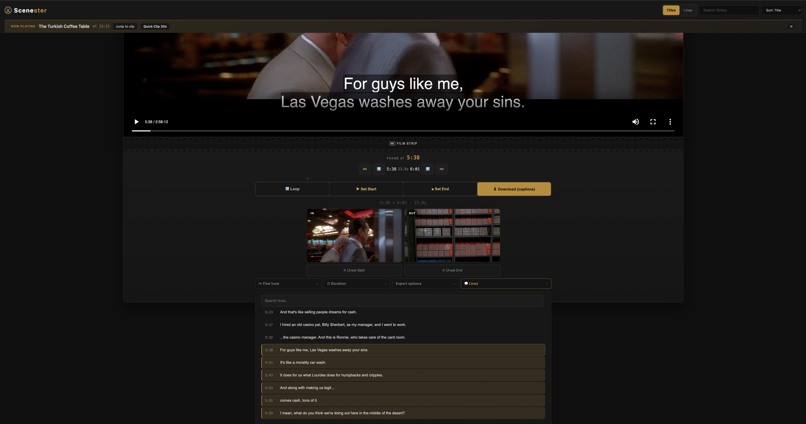
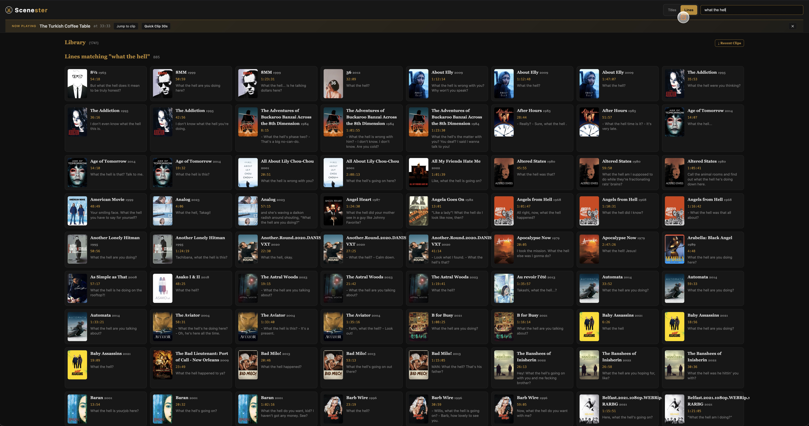
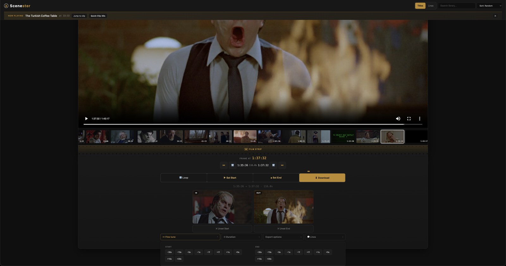
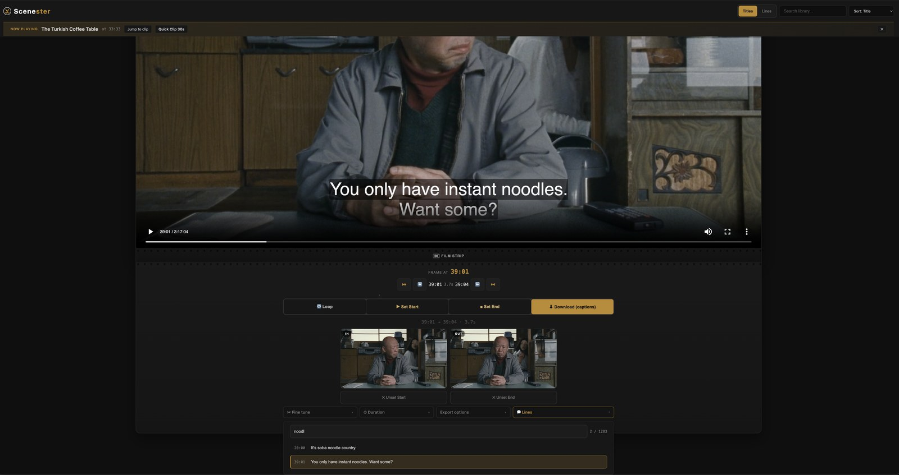
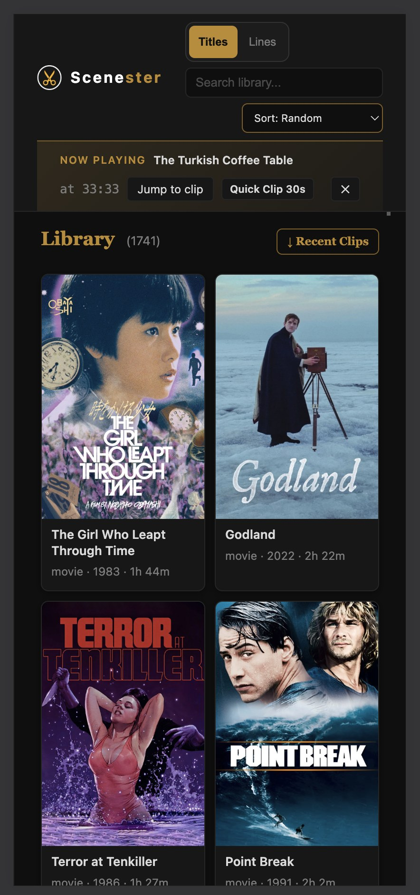
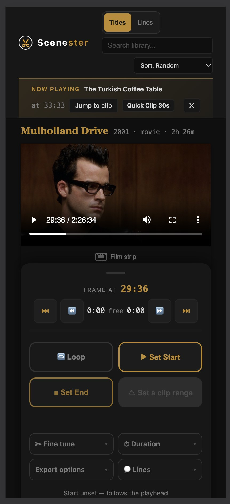

# Scenester

**Clip movies from your Plex library by picking the lines of dialogue you
want.** Browse, scrub a live preview, mark a range, and download a
frame-accurate 1080p clip.

[](https://github.com/vacuumboots/scenester/actions/workflows/ci.yml)
[](https://github.com/vacuumboots/scenester/actions/workflows/docker-publish.yml)
[](#development)
[](https://www.python.org)
[](LICENSE)
[](https://github.com/vacuumboots/scenester/releases)

Self-hosted, one container, no database. It runs unprivileged, exports through
ffmpeg on the server, and uses an Intel iGPU if you have one.

<p align="center">
  
  <br>
  <sub>Filter, open, mark a 13s range while it plays, export. This is a recording of a
  live instance, made by <code>scripts/record_demo.py</code>.</sub>
</p>

<p align="center">
  
  <br>
  <sub>The library: every title on your Plex server, searchable and sortable. The banner shows what's playing right now.</sub>
</p>

<p align="center">
  
  <br>
  <sub>The editor. The movie streams in the page. Mark a start and an end, then download the clip.</sub>
</p>

<p align="center">
  
  <br>
  <sub>Editing by dialogue. Select lines and the clip range follows. Six lines here make a 23.6s clip.</sub>
</p>

<details>
<summary>More screenshots: quote search, frame nudging, transcript search, mobile</summary>

<p align="center">
  
  <br>
  <sub>Quote search, for when you remember the line and forgot the movie. 885 matches for
  &quot;what the hell&quot;, each one a click from clipping.</sub>
</p>

<p align="center">
  
  <br>
  <sub>Fine-tuning. Nudge either edge by single frames, with an optional thumbnail film strip
  for jumping around.</sub>
</p>

<p align="center">
  
  
  
  <br>
  <sub>Searching within one movie's transcript, and the whole workflow on a phone</sub>
</p>

</details>

## What it does

Most clip tools make you drag slider handles and hope. Scenester reads your
subtitles, so the clip range follows the script instead of an abstract
timeline.

- **Edit by dialogue.** Every line under the playhead is listed with its
  timestamp. Tap a line to select it, shift-tap to extend, and the clip's start
  and end snap to the dialogue you picked. Mark Start/End instead and the
  covered lines light up. Both views edit the same range.
- **Quote search across the whole library.** Flip the search box to **Lines**,
  type a phrase, and see which film says it and when. One click opens it ready
  to clip.
- **Audition before committing.** Double-tap a line to loop exactly that span.
- **Frame-precise nudging.** Ten buttons per edge, −30s through +30s, with
  single-frame steps as well (1 frame ≈ 0.04s). Buttons, because fat thumbs
  exist.
- **Extras.** Optional caption burn-in, 9:16 vertical crop, MP4 or GIF output.
- **Full editing on a phone**, portrait and landscape.
- **Plex login** through OAuth (PIN flow) or a preset token. A now-playing
  banner offers Quick Clip for whatever is paused in Plex.

## Architecture


No database. Configuration is environment variables. The Plex token and the
derived-artefact cache share one volume, and clips are plain files on disk.

## Design decisions

Each of these replaced something measurably worse. The code has a comment next
to each one explaining the failure behind it.

- **Re-encode, never stream copy.** Stream copy can only cut on keyframes, which
  can land seconds away from the line you clicked. Every clip is decoded and
  re-encoded so the cut lands on the frame you marked.
- **Subtitles drive the editor.** The `.srt` parser feeds line selection,
  cross-library quote search, and caption burning. The clip range and the
  script are the same object.
- **The filename is the cache key.** It carries title, year, media id, range,
  and every render option. Any option that changes pixels has to change the
  name, or an export silently re-serves the previous render. Title-only names
  collided across same-titled films (this library has three called *Mother*)
  and across non-Latin titles, which all slugged to `unknown`.
- **Write to `.part`, then verify.** Encodes write `<name>.part`, get checked
  with `ffprobe` for a positive duration, and only then get `os.replace`d into
  place. `-movflags +faststart` writes the index last, so a killed encode
  leaves a file that looks fine and opens nowhere.
- **Unprivileged, with the gate in the app.** A reverse proxy can't
  authenticate per app when one Caddy terminates TLS for twenty services. So
  the shared secret lives in the app, the container runs as uid 1000 with no
  capabilities, and the only port binding left is on loopback. Nothing on the
  LAN can reach it until a proxy is put in front.
- **Relative URLs everywhere.** The same build works at `:8096/`, at
  `/scenester/` behind `handle_path`, and behind any other prefix-stripping
  proxy. No configuration, no `<base>` tag.

## Measured

Numbers from the host this runs on (4-core Haswell i5, media on spinning
disks):

| What | Before | After |
|---|---|---|
| 60s clip encode, hardware path | ~111s (libx264) | ~11s (VAAPI) |
| 12s clip encode, measured end to end | n/a | 3.21s (3.7× realtime) |
| Library listing payload | ~490 KB | ~88 KB gzipped |
| Library listing, warm | n/a | ~0.26s |
| Cold film-strip frame | n/a | ~1.3s per frame (a real seek) |
| Tests | 0 | 94 |
| Image rebuild, frontend-only change | 10 to 15 min | ~2.5s |

## Limitations

In the order they're likely to bite:

- **Multi-part films only clip in part 1.** The timeline uses Plex's whole-item
  duration, but path translation returns one part, so a range past the first
  part seeks past EOF. Eight items in this library are affected.
- **`.srt` only.** One directory has `.ass`/`.ssa` files with no `.srt`, and
  about a quarter of titles have no subtitle file at all. Those get no line
  selection and no captions.
- **Previews stream the original file.** There's no 480p proxy, so scrubbing a
  4K remux is limited by the disk, not the CPU. This is a deliberate trade (no
  transcode chain to tune) and the reason the film strip is opt-in.
- **One library, one user, one Plex server.** No accounts, no sharing, nothing
  multi-tenant.
- **Quote search builds an in-memory index.** Here that means ~2,100 films and
  ~1.2M subtitle lines, which takes tens of seconds of seeks on first use. It
  rebuilds after every restart.
- **No share targets.** Uploading straight to a platform is an open question.
  The tool ends at "download the file".

## Setup

One container and one command. Everything not shown below has a default.

```bash
git clone https://github.com/vacuumboots/scenester.git
cd scenester
cp .env.example .env          # set PLEX_URL and (recommended) an access token
docker compose up -d
```

Open `http://localhost:8096` and sign in with Plex, or put `PLEX_TOKEN` in
`.env`.

Two things the compose file expects you to know about your machine:

1. **`PLEX_MEDIA_PATH`**: the left side of the media bind mount has to be the
   folder your Plex library reports its files in. It's mounted read-only
   because Scenester never writes media.
2. **Ownership**: the container runs as uid 1000, so the clip and cache binds
   must be writable by it:
   `mkdir -p clips data && sudo chown -R 1000:1000 clips data`.
   If your ids differ, the compose file has `PUID`, `PGID`, and `RENDER_GID`.
   `getent group render` gives the gid the VAAPI device needs.

<details>
<summary>Not using Compose?</summary>

```bash
docker run -d --name scenester \
  --user 1000:1000 --group-add 992 \
  --cap-drop=ALL --security-opt=no-new-privileges \
  --memory=3g --cpus=3 --pids-limit=512 \
  --add-host=host.docker.internal:host-gateway \
  --device /dev/dri/renderD128 \
  --env-file .env \
  -p 127.0.0.1:8096:8096 \
  -v /path/to/your/media:/media:ro \
  -v "$PWD/clips:/tmp/clips" -v "$PWD/data:/data" \
  --restart unless-stopped \
  ghcr.io/vacuumboots/scenester:latest
```

On a host with no render node, drop `--device` and set
`SCENESTER_DISABLE_VAAPI=1`. If a reverse proxy reaches the container by name on
a shared Docker network, drop `-p` as well. This instance runs that way.
</details>

### Behind a reverse proxy

Any proxy that strips a path prefix works. Caddy:

```
handle_path /scenester/* {
    reverse_proxy scenester:8096
}
```

`scenester:8096` is the container name on a shared Docker network. You can point
the proxy at a published host port instead, but then that port exists for no
reason.

## Configuration

Every setting is optional and documented with its default in
[`.env.example`](.env.example). These are the ones that change behaviour:

| Variable | Default | What it does |
|---|---|---|
| `PLEX_URL` | `http://host.docker.internal:32400` | Where Plex is |
| `PLEX_TOKEN` | none | Skip the in-app login |
| `SCENESTER_ACCESS_TOKEN` | none | Shared secret for the API. Unset means open |
| `SCENESTER_FRAME_CONCURRENCY` | `2` | Concurrent frame extractions. **The load lever** |
| `SCENESTER_CLIP_CONCURRENCY` | `2` | Concurrent encodes (each is a full pipeline) |
| `SCENESTER_CACHE_MAX_AGE_DAYS` | `14` | Prune cached frames/thumbnails |
| `SCENESTER_CLIP_MAX_AGE_DAYS` | `0` | Prune finished clips (0 = keep) |
| `SCENESTER_DISABLE_VAAPI` | none | Force the CPU encoder |

On a dedicated host, only `PLEX_URL` and `PLEX_TOKEN` matter. On a box shared
with Plex, the two concurrency settings decide whether opening the film strip
slows everything else down. 12 concurrent frame requests once took this host
from load 2.1 to 8.6, because each frame is a physical seek.

## Security

Scenester is built to sit on a private network behind a reverse proxy.

- **Shared-secret gate on the API.** Set `SCENESTER_ACCESS_TOKEN` and every
  `/api/*` route requires it: `X-Scenester-Token: <token>` for scripts, or the
  browser's unlock screen, which trades the token for an HttpOnly cookie.
  Unset turns the gate off, which is only sane when nothing but you can reach
  the container.
- **Nothing is published beyond loopback.** The compose file binds
  `127.0.0.1:8096` so you can open the app on the host itself. That address is
  not reachable from the LAN; reach it from anywhere else through a proxy.
- **Unprivileged container.** uid 1000, `--cap-drop=ALL`, `no-new-privileges`,
  and only the render device. It never needs root: no package installs, no
  privileged ports, no writes outside its two volumes.
- **Plex PINs are bound to the client that created them.** Without that, any
  reachable client could start a PIN, approve it with its own Plex account,
  and overwrite the stored token.
- **The Plex token is a file in `/data`**, not in the image or the
  environment, unless you pass `PLEX_TOKEN`.

The gate is one shared secret. It tells "someone on my network" apart from "me"
and nothing more. If you need user accounts, look elsewhere. Multi-user support
is a stated non-goal in the [roadmap](ROADMAP.md).

## Development

The frontend has no build step: plain ES5, one stylesheet, relative URLs.

```bash
pip install -r backend/requirements.txt -r backend/requirements-dev.txt
uvicorn main:app --reload --app-dir backend
python -m pytest -q
```

The image installs dependencies from `backend/requirements.lock.txt` with
`--require-hashes`. After changing `requirements.txt`, regenerate it:

```bash
pip-compile --generate-hashes --output-file requirements.lock.txt requirements.txt
```

`STATIC_DIR` resolves automatically (container layout first, then the repo's
`frontend/`). CI runs the pytest suite and `node --check` on the frontend,
builds the image, and smoke-tests it against `/healthz` before anything is
published.

`/healthz` is the real readiness probe. It checks cache writability, ffmpeg and
ffprobe, and the media mount. `/` and `/api/auth/status` stay 200 even when the
app is useless, so the container healthcheck doesn't use them.

The demo loop is generated, not hand-recorded. `scripts/record_demo.py` drives
a real instance in headless Chrome over the DevTools Protocol, clicks the app's
own buttons, and captures frames for ffmpeg to assemble. Point it at your own
instance to re-shoot the loop.

### Keyboard shortcuts

| Key | Action |
|-----|--------|
| I / O | Mark clip start / end |
| Space | Play / pause |
| ← → | Nudge start ±1s (Shift = ±10s) |
| Alt + ← → | Nudge end ±1s (Shift = ±10s) |
| Enter | Download clip |
| Escape | Back to library |

## How this was built

I built this for something I actually do: cutting clips out of films to post.
It has been in daily use since July, and the bug stories are in
[`CHANGELOG.md`](CHANGELOG.md), the self-audit is in
[`docs/audits/`](docs/audits/), and what's next is in [ROADMAP.md](ROADMAP.md).

An AI assistant (DeepSeek) did much of the typing. I say so up front because it
changes what the code is evidence of. The design decisions, the debugging, the
measurements, and every claim in this README are mine to defend, and the
mistakes are in the changelog next to the fixes. Take the pure-green encode,
caused by a corrupt NV12 surface coming back from `hwdownload` on i965. Finding
that took a session with `ffmpeg -loglevel debug` and a colour histogram, and I
did it myself.

## License

MIT
