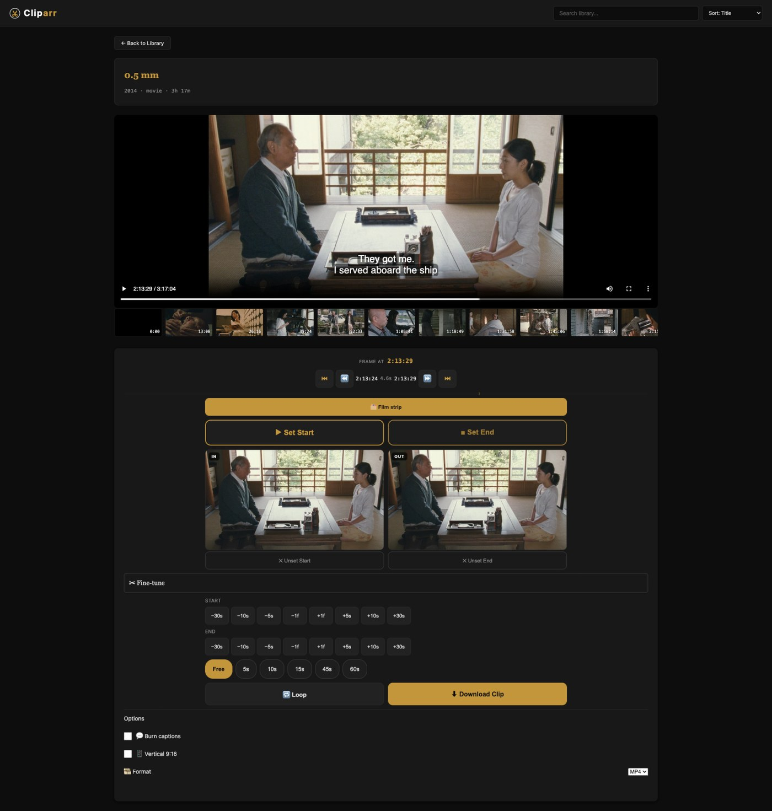
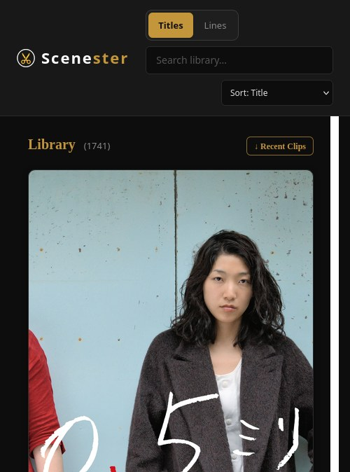
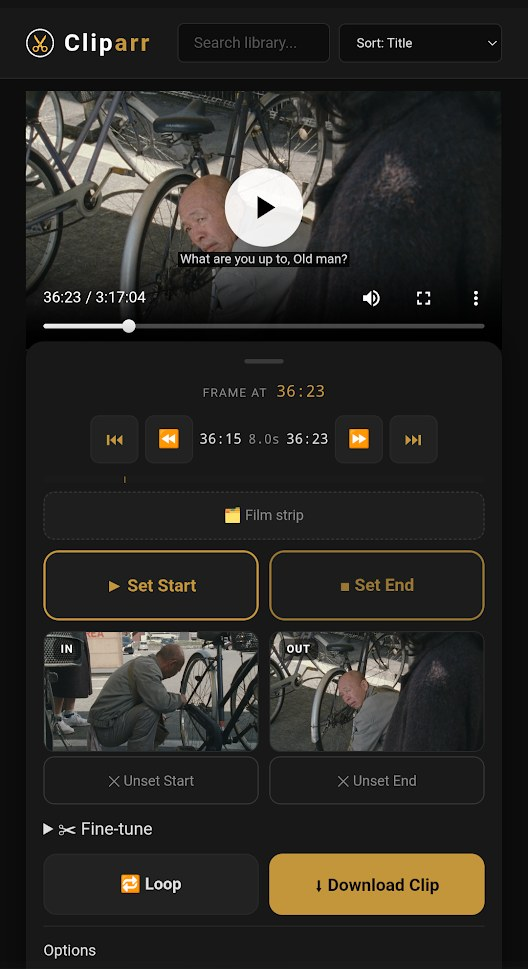

# Cliparr

## Proudly vibecoded with Deepseek 🐋

Cliparr clips movies from your Plex library. Browse, scrub a live video preview,
mark a range with two buttons, and download frame-accurate 1080p clips.

<p align="center">
  
  
</p>
<p align="center">
  
  
</p>

## Features

- **Video-first preview** — direct media streaming with byte-range seeking; the
  native `<video>` controls are the only scrubber.
- **Unified mark-from-playhead editor** — one selection model on desktop and
  mobile: play to a moment and tap **Set Start**, play on and tap **Set End**.
  Unset buttons free an edge to ride the playhead again.
- **Frame-precise nudging** — explicit Start/End rows of −30s −10s −5s −1f +1f
  +5s +10s +30s (1 frame ≈ 0.04s). Fat-thumb accessible.
- **Duration presets** — Free (default) plus 5s / 10s / 15s / 45s / 60s.
- **Looped clip preview** — 🔁 Loop auditions the selected range before download.
- **Opt-in film strip** — a navigation-only thumbnail strip (🗂 toggle): tap a
  frame to move the playhead. It never marks clip edges.
- **Plex OAuth login** — PIN flow via plex.tv, or set `PLEX_TOKEN`.
- **Human-readable filenames** — `Inception_5307.2-5337.4.mp4` (one-decimal
  sub-second precision, so distinct clips never collide).
- **VAAPI-accelerated clips** — hardware encode/decode on Intel iGPUs with a
  transparent libx264 software fallback.
- **Clip gallery** — playback and delete generated clips.
- **Now-playing banner** — Quick Clip (30s) and Jump-to-clip for paused sessions.
- **Dark theme** — immich-inspired design system.

## Setup

### Prerequisites

- Docker
- A Plex server on your local network
- Media files mounted as a Docker volume

### 1. Configure

```bash
cp .env.example .env
```

Edit `.env`:

```
PLEX_URL=http://host.docker.internal:32400
# PLEX_TOKEN=...   (optional — OAuth login is preferred)
```

### 2. Build and run

```bash
docker build -t cliparr .
docker run -d --name cliparr \
  --add-host=host.docker.internal:host-gateway \
  --device /dev/dri/renderD128 \
  -p 8096:8096 \
  -v /path/to/your/media:/media:ro \
  -v /path/to/clips:/tmp/clips \
  -v /path/to/data:/data \
  --env-file .env \
  --restart unless-stopped \
  cliparr
```

- `--add-host=host.docker.internal:host-gateway` is **required on Linux** —
  without it Plex API calls fail.
- `--device /dev/dri/renderD128` enables VAAPI hardware clipping. Omit it (or
  set `CLIPARR_DISABLE_VAAPI=1`) to force the libx264 fallback.
- Prefer pulling a prebuilt image over building? `docker pull
  ghcr.io/vacuumboots/cliparr:latest` — the image is rebuilt automatically on
  every push to `main` (see section 3).

### 3. Run with Docker Compose (alternative)

`compose.yaml` equivalent of the `docker run` above:

```yaml
services:
  cliparr:
    image: ghcr.io/vacuumboots/cliparr:latest   # prebuilt — rebuilt on every push to main
    # build: .   # alternative: build from source instead of pulling
    container_name: cliparr
    restart: unless-stopped
    ports:
      - "8096:8096"
    env_file: .env
    extra_hosts:
      - "host.docker.internal:host-gateway"   # required on Linux
    devices:
      - /dev/dri/renderD128:/dev/dri/renderD128   # VAAPI; omit for libx264 fallback
    volumes:
      - /path/to/your/media:/media:ro
      - /path/to/clips:/tmp/clips
      - /path/to/data:/data
```

```bash
docker compose up -d
```

`extra_hosts` is the compose spelling of `--add-host`; `image:` pulls the
prebuilt image from GitHub Container Registry, and `build: .` is the
build-from-source alternative.

### 4. Serve behind a reverse proxy (optional)

Caddy example:

```
handle_path /cliparr/* {
    reverse_proxy localhost:8096
}
```

Traefik or nginx work the same way — any reverse proxy that strips the
`/cliparr` path prefix.

## Usage

1. Open the app — connect with Plex OAuth (or a pre-set token).
2. Browse or search your movie library.
3. Click a title to open the detail view.
4. Play or scrub to your in-point and click **Set Start**, then to your
   out-point and click **Set End** (or pick a duration preset).
5. Fine-tune with the nudge rows, then click **⬇ Download Clip**.

### Keyboard shortcuts

| Key | Action |
|-----|--------|
| I | Mark clip start |
| O | Mark clip end |
| Space | Play / pause |
| ← → | Nudge start ±1s (Shift = ±10s) |
| Alt + ← → | Nudge end ±1s (Shift = ±10s) |
| Enter | Download clip |
| Escape | Back to library |

## Security

Cliparr is designed to run on a **private home network behind a reverse proxy**
(Caddy, Traefik, or nginx). Within that trust boundary the API is
unauthenticated — OAuth exists only to obtain a Plex token for library access,
not to gate Cliparr's own endpoints.

Do **not** expose the container port (8096) directly to the internet. Put
authentication or access control in front of Cliparr at the reverse proxy (or
your network layer), not in the app itself.

## Tech Stack

- **Backend:** Python 3.12, FastAPI, httpx, ffmpeg (CLI, raw argument lists)
- **Frontend:** Vanilla JS, HTML, CSS — no frameworks, no build step
- **Container:** Docker, two-stage build (alpine → python:3.12-slim)
- **Reverse proxy:** Caddy (or Traefik / nginx)

## Development

Run the backend locally without Docker (the frontend needs no build step):

```bash
pip install -r backend/requirements.txt -r backend/requirements-dev.txt
uvicorn main:app --reload --app-dir backend
```

`STATIC_DIR` resolves automatically: the container layout (`backend/static`)
when present, otherwise the repo-layout `frontend/` directory. Override with
`CLIPARR_STATIC_DIR` if your checkout differs.

Run the tests:

```bash
python -m pytest
```

CI (`.github/workflows/ci.yml`) runs the same pytest suite on Python 3.12 plus
a `node --check` syntax gate on the frontend JS.

## VAAPI-accelerated clipping

Cliparr hardware-accelerates clip generation on Intel iGPUs via ffmpeg's VAAPI
support, with a transparent software fallback:

- **Tier 1** — GPU decode + scale + encode (h264/mpeg2/vc1 sources)
- **Tier 2** — CPU decode + GPU encode (hevc/vp9/av1)
- **Tier 3** — libx264 software fallback (no `/dev/dri`, or a VAAPI run fails)

Enable it with `--device /dev/dri/renderD128` at `docker run`;
`CLIPARR_DISABLE_VAAPI=1` forces the fallback. On a Haswell i5 a 60s clip drops
from ~111s (libx264) to ~11s (VAAPI).
